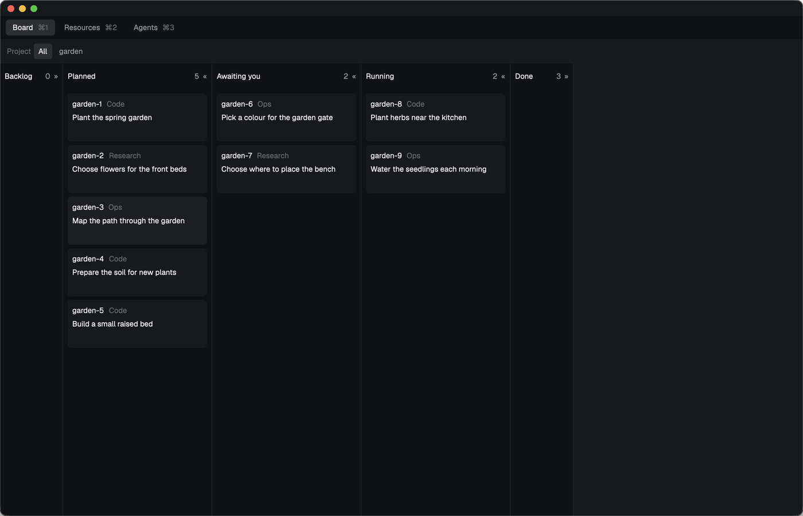
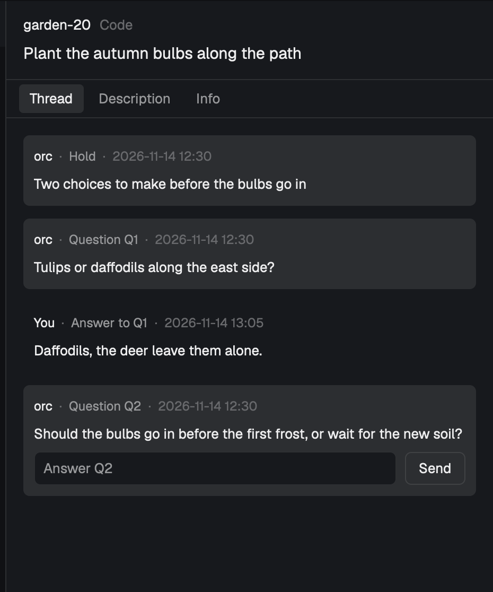
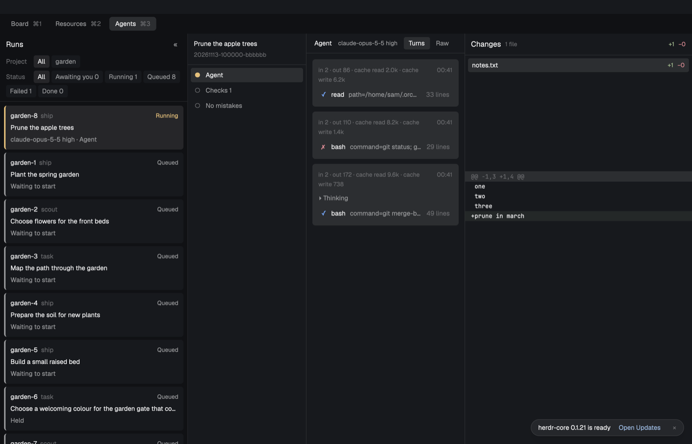
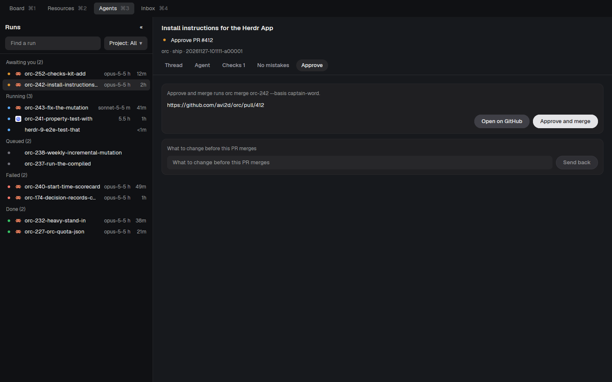
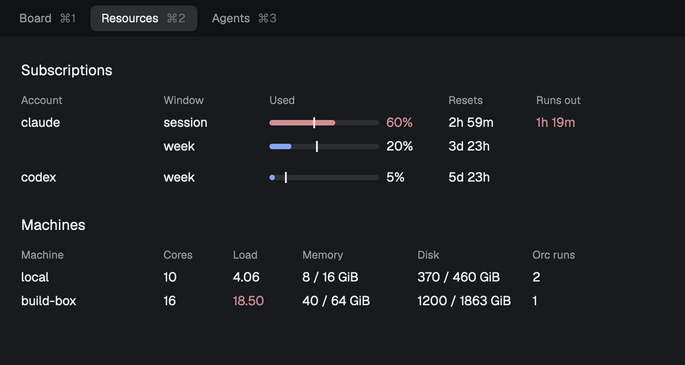

# The app and the dashboard

Orc has two screens, a layout for the Herdr App and the `orc-dash` terminal dashboard, and neither holds any state of its own.
Both only run the `orc` commands and draw what those commands print, so the screens and the command line never disagree.

## The Board tab

The Board shows the backlog as cards in five lanes: Backlog, Planned, Awaiting you, Running and Done.
Awaiting you gathers held tasks, parked questions, open attention items for you and closed tasks whose pull request is still open.

Selecting a card opens the task panel, with the task's whole conversation and its open questions to answer.

## The Agents tab

The Agents tab lists the runs and the queued tasks.
For the selected run it shows each step, the agent's turns, and the changes on the branch.

A run whose pull request waits for your word ends in an Approve step, which merges through `orc merge`.

## The Resources tab

The Resources tab shows each account's quota windows and each machine's cores, load, memory, disk and running orc runs.

## The chat drawer

Pressing `cmd-k` on any tab opens a drawer that runs `orc chat`.
It is the same chat as in a terminal, with the same sixteen tools.

## The terminal dashboard

`orc-dash` shows the same facts in a terminal, as panels for quota, session quota, resources, queues, schedules, dispatch, attention, tasks, alerts and ledger.
It also watches quota pace, machine load and long tasks, and its alert stream is where the chat's alerts come from.

## Related topics

- [Show orc in the Herdr App](../herdr-app.md)
- [orc-dash](../dash.md)
- [The chat](chat.md)
- [Seeing runs](../run/seeing-runs.md)
