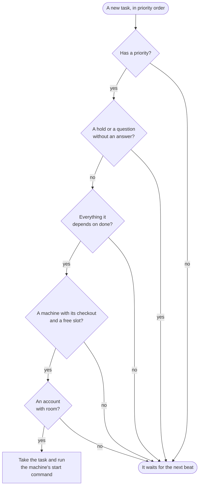

# The beat

The beat is one pass of `orc beat`, the command that starts every task that can start and closes every task whose run finished.
Orc has no daemon of its own, so cron or launchd runs the beat every few minutes.
Each beat reads the whole state from disk.

## The five conditions

A task starts only once all five hold.

1. It has a priority.
1. No hold and no parked question waits on it without an answer.
1. Every task it depends on closed done.
   A ship task also waits for the pull request of each ship task it depends on to merge.
1. Its project has a checkout on a machine with a free slot.
1. An account has room above 0% and at or above the floor.

A decision never starts, whatever else holds.
For each task that does not start, the beat prints `waits <task-id>:` with the reason.

## The order of starts

The beat considers the new tasks in priority order, so when slots run short the first in that order start.
Priority 0 goes first.
Among tasks of one priority the oldest goes first.
A task marked for one machine waits for a slot there and never starts on another.

## The machine it picks

`dispatch.json` names each machine, its slots and its start command.
`projects.json` names each project and the path of its checkout on each machine.
Among the machines that hold the project's checkout, the beat takes the one with the most free slots.
A machine with a `loadLimit` takes no new task while its five-minute load is above the limit.
A machine also takes no new task while 3 or more calls wait in its heavy queue.

## What else a beat does

A beat is also how every finished or waiting run gets attention.

- It reads `orc runner result` for each started task and closes the task done, failed or stopped.
- It parks a task whose run stopped on a question, and resumes it once every question has an answer.
- It hands your answers to a run that still waits at its gate.
- It opens and withdraws items in the attention queue, and gives the decider its questions.
- It reads the pull request of each closed ship task and records when it turns green, merges or closes.
- It flags a run whose output has not grown for 30 minutes as stalled.
- On a token command account, it sends each started task its account's fresh token.

To see what one beat did as data, run `orc beat --json`.

## Related topics

- [The backlog](backlog.md)
- [Accounts and quota](accounts-and-quota.md)
- [The runner](runner.md)
- [The backlog and the beat](../run/backlog-and-beat.md)
