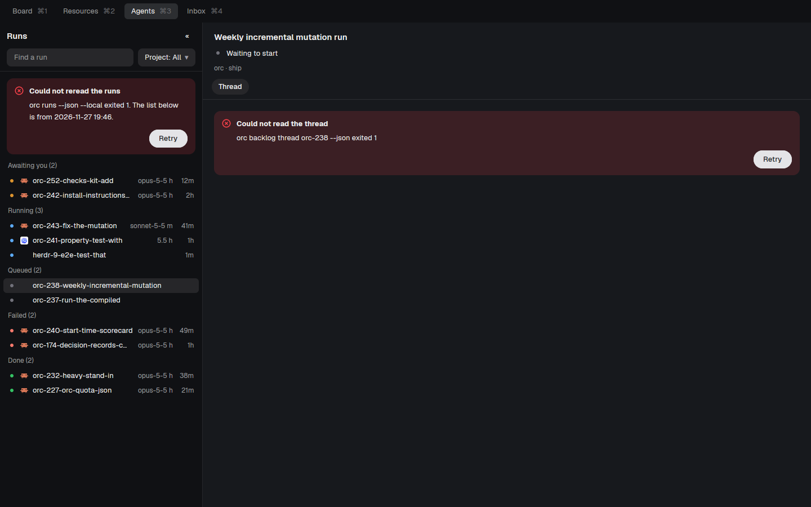
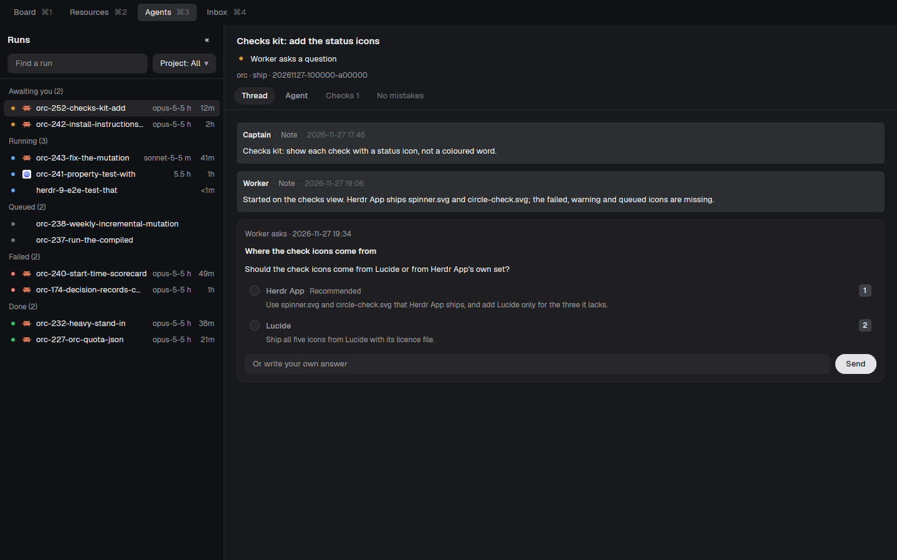

# Follow runs and chat in the Herdr App

Select **Agents** or press `cmd-3` in the [Herdr App](https://herdr.dev) to follow a run.
Press `cmd-k` to open or close the chat drawer.

## Follow a run in the Agents tab

### Read the run list

The list shows runs and queued tasks under five headers: **Awaiting you**, **Running**, **Queued**, **Failed** and **Done**.
Each header shows its count after its name.
Select a header to fold or unfold its rows.
Each row shows a status dot, the agent's logo, the task ID with the first words of its title, and a time.
The model and effort sit before the time, such as `opus-5-5 h`.
On an **Awaiting you** row, what the task waits on replaces the model, such as `PR #48`, `question` or `2 items`.
The time is how long a question has waited on you, how long a running run has run, or how long a finished run took.
Type in **Find a run** to show only the runs whose task ID or title holds those words.
A hold you set without a question parks its task under **Queued**.
A hold question or an overdue hold still puts it under **Awaiting you**.
A queued task whose hold waits on other tasks reads **Waits on** and their IDs.
Those tasks are its open children and dependencies, its children done as ship tasks whose PR is not merged, the same kind of dependency when the held task is a ship task, and a dependency the backlog does not hold.
The **Project** select shows runs for configured projects by default.
Choose **All runs** in it to include runs from other projects.
Opening a run of another project from the Inbox switches the **Project** select to **All runs**.
The **Project** select shows its current choice, and its open list shows a count for every choice.
A merged PR shows its run as Done.
A closed PR shows its run as Failed.
Select « to collapse the list and » to open it.

### When the list cannot be reread

The list rereads the runs while you watch.
If a reread fails, a card above the list says why and when the list below was read.
Select **Retry** on it to read the runs again.
A Thread that cannot be read shows the same kind of card with **Retry**.

### Open a run

Select a run to open it on the right.
Its header shows the task's title and a status dot with what the run waits on or why it stopped.
It also shows the project, route and run ID.
Below the header, one row of tabs holds **Thread** first, then one tab per step, then **Approve** or **Send back** while a PR is open.
Steps that share a name are numbered by their place in the run, such as **Checks 1** and **Checks 2**.
Steps still to come are dim.
If a step's model differs from the Agent step's, point at its tab to see the model.

A run opens on the tab that needs you:

| Run | Opens on |
| --- | --- |
| Awaiting you, with a question | Thread |
| Awaiting you, with a PR to approve | Approve |
| Queued | Thread |
| Running | the step that runs now |
| Failed | the step that failed |
| Done, with an open PR | Send back |
| Done otherwise | the last step |

[Pi](https://pi.dev) steps show a card for each reply.
If a Pi step has no replies yet, it shows its log.
Checks steps show one row per check, as [Read a Checks step](herdr-app.md#read-a-checks-step) describes.
Other steps show their log.

### Answer a run's question

The **Thread** tab shows the task's thread, then the open question of the run.
Each option shows its outcome and its number, and the recommended option says **Recommended**.

1. Select an option, or type its number into the empty answer box.
   Its text fills the box, and the option is marked.
1. Change the words if you need to, or type your own answer.
1. Press Enter or select **Send**.

When the step that asked is running, its tab names the question with **Open in Thread**.

### Approve a run's PR

In the Agents tab, merge from the **Approve** tab with **Approve and merge**.
On the Inbox page, select **merge** on the PR's **Awaiting you** card and confirm the dialog.
Select **hold** on that Inbox card to leave the PR open and clear the request.
Select the PR address to open it in your browser.
To send the task back instead, write what to change in the box under **What to change before this PR merges** and select **Send back**.

To merge the PR:

1. Select the **Approve** tab.
1. Select Approve and merge.
1. Confirm the dialog.

The App runs `orc merge <task> --basis captain-word`.
While it runs, the button names the stage Orc records in the task file.
When the PR is behind main, the button reads **Updating from main** and then **Checks running**.
If the command fails, the error appears under the button.
If the update conflicts, **Merge conflict with main** appears there instead of the error.
If a check is red, **Check failed** and the name of the check appear there instead.
When the merge sends the task back, its card reads **Sent back** with the PR and stage, such as **Sent back PR #48: Merge conflict**.
When you send the task back yourself, Orc drops the recorded stage and the card reads **Sent back** with the PR alone.
When the beat retries a run that finished with a PR but whose task then failed, that run's card reads **Retried** with the PR, such as **Retried PR #48**.

### Read a run's changes

The Changes column lists changed files and their added and deleted lines.
Select a file to read its diff.
The diff compares the branch with the commit where it left `origin/HEAD`.
The column is absent when no files changed or the worktree is unavailable.

## Chat with orc

Press `cmd-k` to open the drawer.
Select its terminal before typing to `orc chat`.
In Raw view, Escape interrupts Pi rather than closing the drawer.
Select ✕ to close it, or switch to Turns and press Escape.

Turns is read only and shows each model reply, its tokens, and its tool calls.
Select Thinking for the model's thinking, or select a finished tool call for its output.

### When the chat stops and resumes

Closing the drawer stops the chat and Pi but keeps the session file in `~/.orc/chat/`.
Deleting the session file, or quitting the App, also stops the chat.
Opening the drawer, or switching views after the terminal exits, starts the chat again on the newest session file in `~/.orc/chat/`.
It starts a new session file only when that folder holds none.
When the App loads the drawer, it ends a chat that an earlier Orc release's drawer left running.
