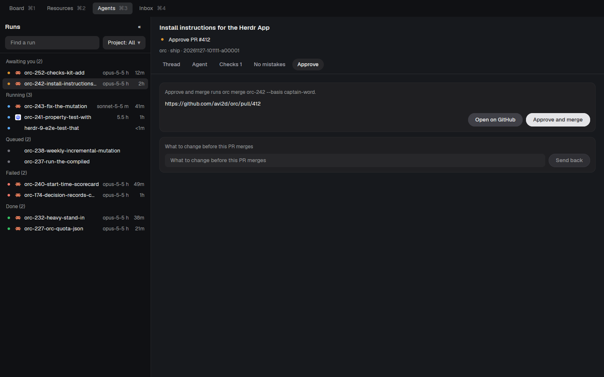

# Follow runs and chat in the Herdr App

Select **Agents** or press `cmd-3` in the [Herdr App](https://herdr.dev) to follow a run.
Press `cmd-k` to open or close the chat drawer.

## Follow a run in the Agents tab

The list shows runs and queued tasks, grouped by status.
The **Project** select shows runs for configured projects by default.
Choose **All runs** in it to include runs from other projects.
Opening a run of another project from the Inbox switches the **Project** select to **All runs**.
Open the **Project** or **Status** select to filter the list.
Each select shows its current choice and count, and its open list shows a count for every choice.
A merged PR shows its run as Done.
A closed PR shows its run as Failed.
Select « to collapse the list and » to open it.

Select a run to see its steps.
A ship run shows Agent, Checks, Fix when needed, and No mistakes or PR for its delivery mode.
A report run shows only Agent.
A resumed run lists carried steps under their original run.
Select a step to read its output.

[Pi](https://pi.dev) steps open in Turns, with a card for each reply.
Select Raw to follow the log, or Turns to return to the cards.
Checks steps open in Summary, as [Read a Checks step](herdr-app.md#read-a-checks-step) describes.
Other steps without a Pi session show their log.

### Approve a run's PR

When Orc asks you to merge a PR, select **merge** on its **Awaiting you** card and confirm the dialog.
Select **hold** to leave the PR open and clear that request.
You can also merge from the Approve step.
Select the PR address to open it in your browser.

To merge the PR:

1. Select the Approve step.
1. Select Approve and merge.
1. Confirm the dialog.

The App runs `orc merge <task> --basis captain-word`.
While it runs, the button names the stage Orc records in the task file.
When the PR is behind main, the button reads **Updating from main** and then **Checks running**.
If the command fails, the error appears under the button.
If the update conflicts, **Merge conflict with main** appears there instead of the error.
If a check is red, **Check failed** and the name of the check appear there instead.
When the merge sends the task back, its card reads **Sent back** with the PR and stage, such as **Sent back PR #48: Merge conflict**.
When you send the task back yourself, Orc drops the recorded stage and the card reads **Sent back** with the PR alone.
When the beat retries a run that finished with a PR but whose task then failed, that run's card reads **Retried** with the PR, such as **Retried PR #48**.

### Read a run's changes

The Changes column lists changed files and their added and deleted lines.
Select a file to read its diff.
The diff compares the branch with the commit where it left `origin/HEAD`.
The column is absent when no files changed or the worktree is unavailable.

## Chat with orc

Press `cmd-k` to open the drawer.
Select its terminal before typing to `orc chat`.
In Raw view, Escape interrupts Pi rather than closing the drawer.
Select ✕ to close it, or switch to Turns and press Escape.

Turns is read only and shows each model reply, its tokens, and its tool calls.
Select Thinking for the model's thinking, or select a finished tool call for its output.

### When the chat stops and resumes

Closing the drawer stops the chat and Pi but keeps the session file in `~/.orc/chat/`.
Deleting the session file, or quitting the App, also stops the chat.
Opening the drawer, or switching views after the terminal exits, starts the chat again on the newest session file in `~/.orc/chat/`.
It starts a new session file only when that folder holds none.
When the App loads the drawer, it ends a chat that an earlier Orc release's drawer left running.
