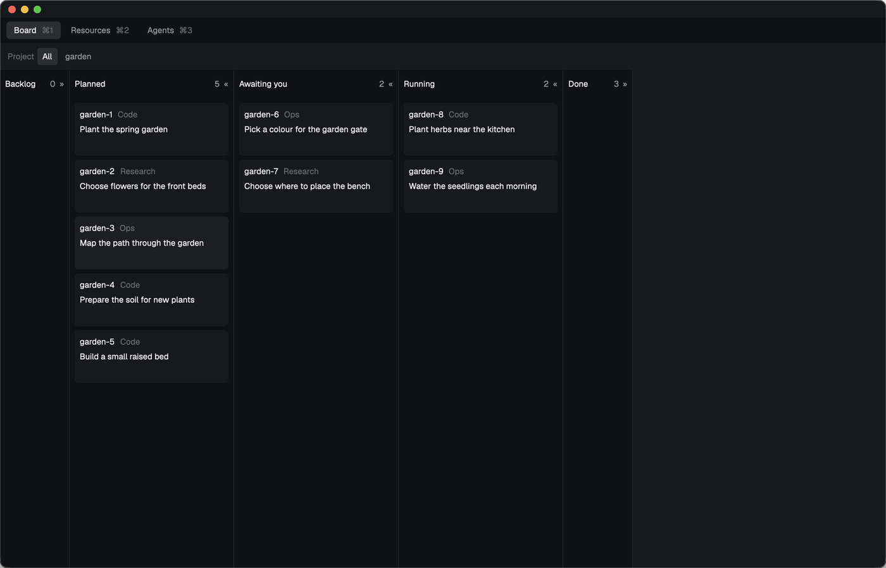
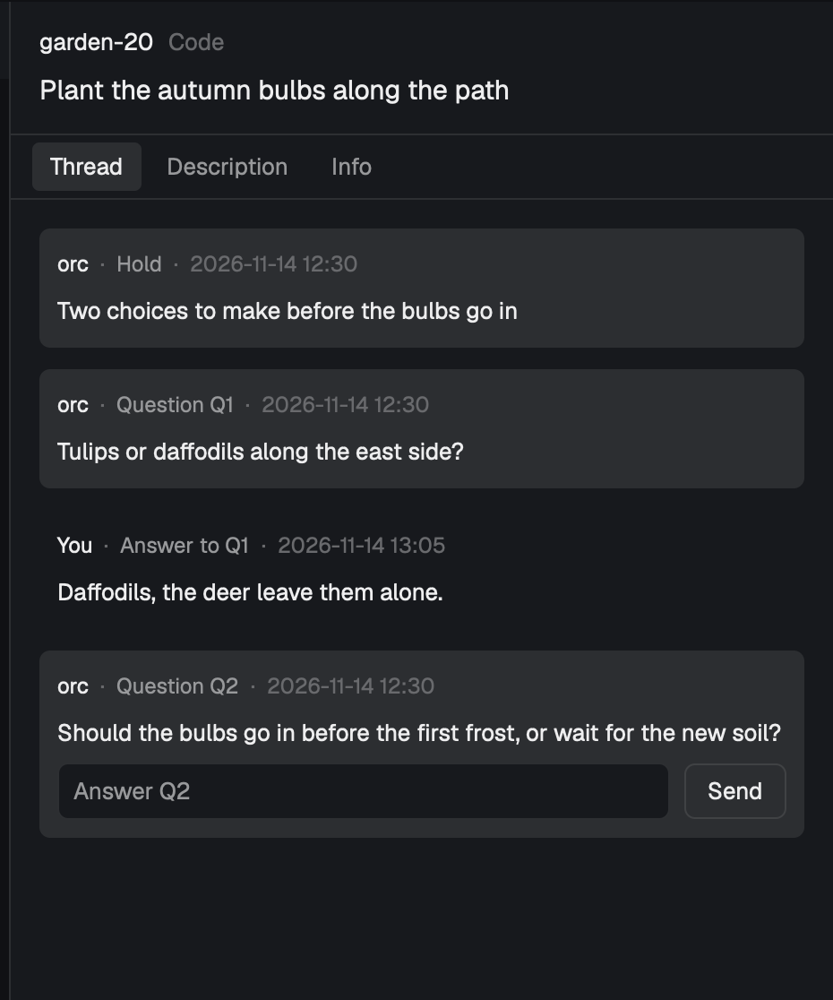
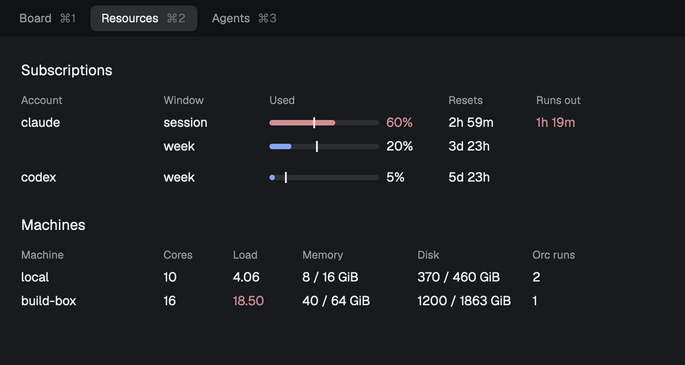
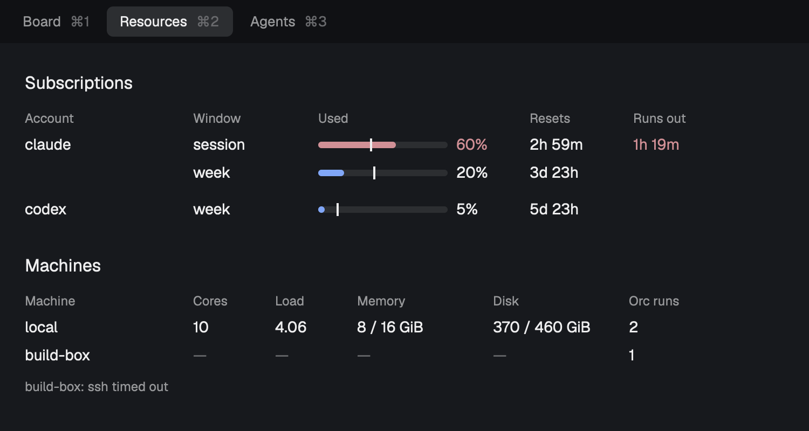

# Read the Board and Resources tabs

Select **Board** or press `cmd-1` to inspect backlog tasks.
Select **Resources** or press `cmd-2` to see quota and machine capacity.

## Read the Board tab

The Board places new tasks in Planned, running tasks in Running, and closed tasks in Done.
A task appears in Awaiting you when the Inbox lists an item for it, so the lane and the Inbox agree.
A question the agent owns leaves the task in its own lane.
Backlog stays empty.
A queued card names the machine and, when available, how many tasks are ahead.

Select a project to filter the lanes, or select All to show every project.
Select a lane header to fold or open it.
Backlog and Done start folded.
Each lane scrolls independently.
Click inside a lane before using the arrow keys, Page Up, Page Down, Home, or End.

## Read a task

Select a card to open its task panel.
Select it again, press Escape, or select ✕ to close the panel.
The panel keeps its state when you switch tabs.

| Tab | What it shows |
| --- | --- |
| Thread | Questions, answers, decisions, and notes in time order |
| Description | The task body |
| Info | The account, run, branch, PR, dependencies, times, priority, and assets |

Select an answer option, or type an answer and select Send.
The panel shows an error if the answer command fails.
A run event question has no answer box.
Select **Open run** to see the newest local run in Agents.
While a task is queued, its queue position replaces that button.

Select a PR link to open it in your browser.
For an open PR, select **Merge** and confirm to run `orc merge <task> --basis captain-word`.

## Read the Resources tab

Subscriptions shows each account's quota windows.
The Used bar compares usage with elapsed time and turns red when usage is ahead.
Runs out shows an estimate only when the quota will run out before reset.

Machines shows local and configured remote resources.
Load turns red above the machine's core count.
Orc runs counts running [pueue](https://github.com/Nukesor/pueue) tasks in the `orc` group.
An unreadable machine shows dashes and a reason below the table.

