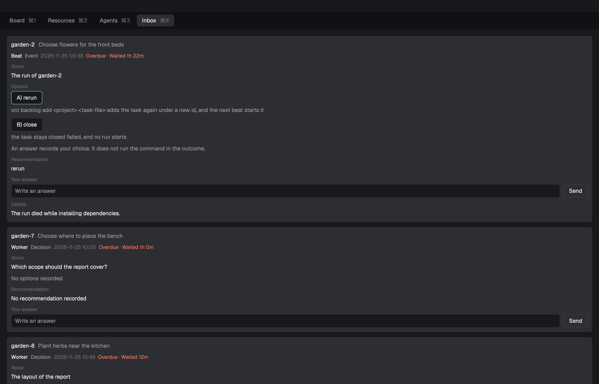
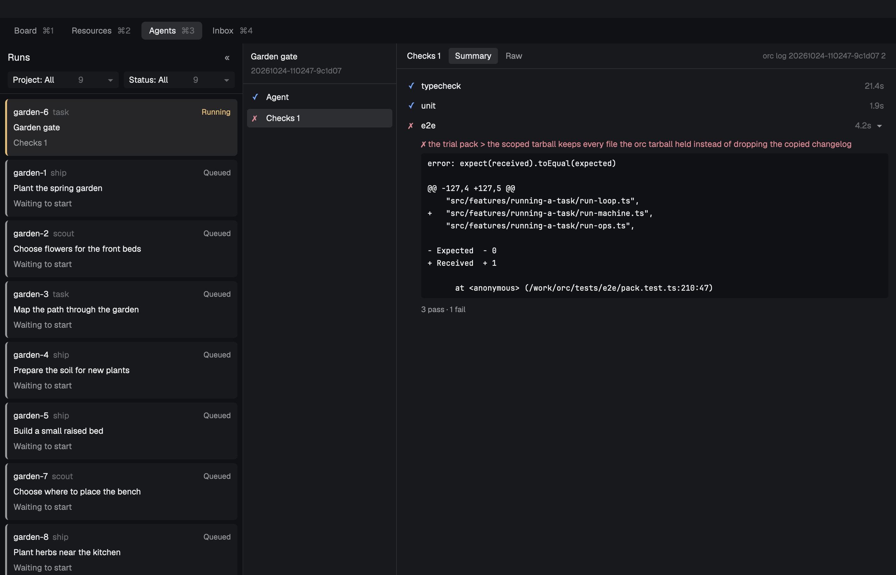

# Show orc in the Herdr App

The `orc` layout adds Board, Resources, Agents, and Inbox tabs to the [Herdr App](https://herdr.dev), with chat available on each tab.
Run `orc app install` after each orc upgrade to update the mods.
The command builds mods from a checkout, so a separate `bun run build` is not needed.

## Before you begin

- The Herdr App, run at least once so that `~/.config/herdr-app` exists.
- `orc` on the `PATH` of your login shell, since the mods run it through the App.
- `orc-dash` on that `PATH` too, for the Resources tab.
- For a second machine on the Resources tab, `ORC_DASH_REMOTE_RESOURCES` and `ORC_DASH_REMOTE_PUEUE` set where the App runs, as [orc-dash](dash.md) describes.

## Install the layout

To install the layout:

1. Run `orc app install`.
1. Run `herdr-app do layout.switch --name orc`, or press the `layout.switch` key until the `orc` layout shows.
   Check `keys.json` for your `layout.switch` binding.
   Use it again to return to your other layout.

The install command copies the `orc-tabs`, `orc-board`, `orc-task`, `orc-resources`, `orc-agents`, `orc-changes`, `orc-inbox`, and `orc-drawer` mods into `~/.config/herdr-app/mods/`.
It also copies `orc.json` and `orc.svg` to `~/.config/herdr-app/layouts/`.
It adds `cmd-1`, `cmd-2`, `cmd-3`, `cmd-4`, and `cmd-k` under `layout:orc` in `keys.json`.
Existing bindings stay in place and are reported as skipped.
The command writes only names beginning with `orc`, leaving Herdr's own mods and layouts untouched.

## Read the tabs

| Tab | Key | What it shows |
| --- | --- | --- |
| Board | `cmd-1` | The backlog tasks in five lanes, and the task panel for the selected card |
| Resources | `cmd-2` | Each subscription's quota windows, and each machine's cores, load, memory, disk and running orc runs |
| Agents | `cmd-3` | The runs and the queued tasks, and the selected run's steps, step output and changes |
| Inbox | `cmd-4` | Every open question, decision, hold, event and PR that Orc assigns to you, across all tasks |

The tabs refresh while visible and show a reason when a command fails.

## Answer in the Inbox

Select **Inbox** or press `cmd-4` to see everything Orc assigns to you, oldest first.

Each card shows the task ID and title, who asks, the subject, each option with its outcome, and the recommendation.
An option with a picture shows as a tile, and others as buttons.
The Inbox outlines the recommended option.
If Orc did not record options, the card shows the original text and says **No options recorded**.
An overdue card shows how long it has waited.
A hold without questions on a task that waits on other tasks, its children or its dependencies, has no card.
A closed ship child, or the closed ship dependency of a ship task, still counts until its PR merges.
A dependency the backlog does not hold counts too.
An answer would not start that task, so its Agents card and its task panel read **Waits on** and those task IDs instead.
The hold returns to the Inbox once Orc no longer waits on those tasks, or as an overdue card once its date passes.
The Agents tab shows the same cards under each run in **Awaiting you**.

To answer a question, a decision, a hold or an event:

1. Click an option, or type an answer and press Enter or **Send**.
1. The Inbox runs the command for that item, and the card shows **Answer recorded**:
   - `orc backlog answer <task> <id>=<answer>` for a question or a decision.
   - `orc backlog answer <task> <answer>` for a hold.
   - `orc attention answer <item> <answer>` for an event, such as a run that died.
     It does not run the option's outcome.

For an overdue hold, type an answer, or click **drop** and give a reason to run `orc backlog drop <task> <reason>`.

To merge a PR that waits:

1. Click **merge**, or **Merge PR** when Orc recorded no options.
1. Confirm the dialog, and the Inbox runs `orc merge <task> --basis captain-word`.

Click **hold** to leave the PR open, and the Inbox runs `orc attention answer <item> hold`.
A failed command shows the first line of its error on its card.

Questions the agent owns, and its answers, stay in the collapsed **Agent attention** section at the end, each with its basis.
Where you replaced an agent's answer, your answer shows beside it as **Decided by you**.

## Tab guides

[Board and Resources](herdr-app-board.md) covers tasks, quota, and machine capacity.
On the Board tab, click the count in the **Awaiting you** lane header to open the Inbox, as `cmd-4` does.

[Runs and chat](herdr-app-agents.md) covers the Agents tab and chat drawer.
On the Agents tab, open the **Status** select and click the count beside **Awaiting you** to open the Inbox, as `cmd-4` does.
The **Project** select shows runs for configured projects by default.
Choose **All runs** in it to include runs from other projects.
Opening a run of another project from the Inbox switches the **Project** select to **All runs**.
A merged PR shows its run as Done, and a closed PR shows its run as Failed.
The Approve step names each stage of a merge, as [Approve a run's PR](herdr-app-agents.md#approve-a-runs-pr) says.

[Develop the mods](herdr-app-development.md) covers the scratch App and screenshots.

## Read a Checks step

On the **Agents** tab, select a run and then select a **Checks** step.
By default, **Summary** shows one row per check with its name, result, and time.
If a log has no recorded check boundaries, **Summary** shows a note instead of check rows.

Passed checks stay folded.
A failed check opens below its row.
Select the row to fold or reopen it.
For a failed `bun test` check, **Summary** shows the failed test names, their errors, and the pass and fail counts.
For other failed checks, it shows the last 20 lines before the exit.
If the step ended before a check reported its result, the row says **Interrupted**.

Select **Raw** in the step bar to see the full log.
The tab keeps **Raw** selected when you move between steps or runs.
Select **Summary** on a Checks step or **Turns** on an Agent step to switch back.

## Related topics

- [The orc-dash dashboard](dash.md)
- [Contribute](contribute.md)
