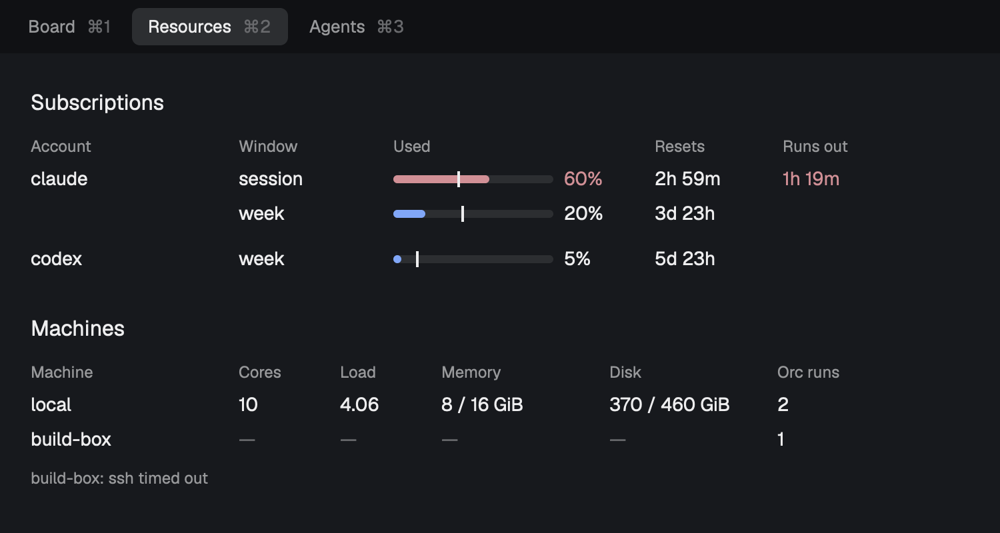
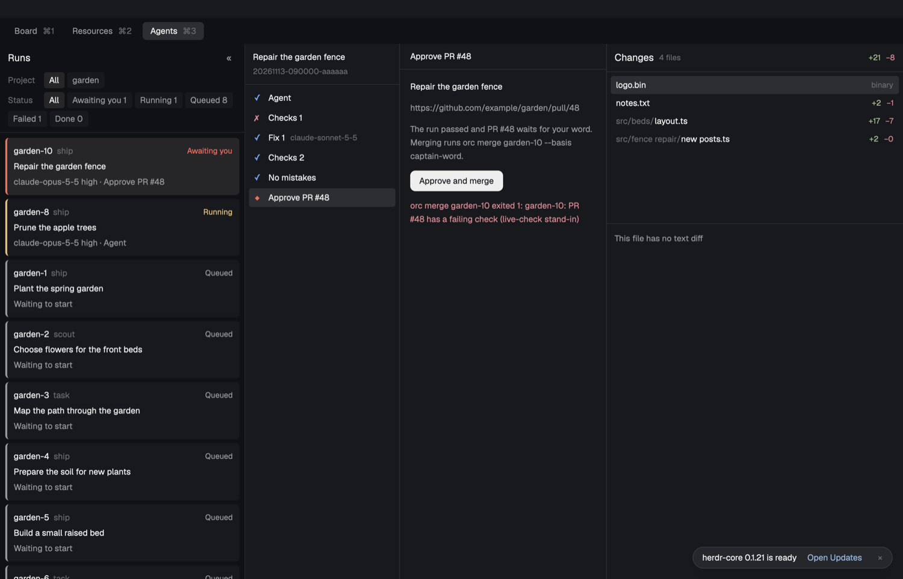

# Show orc in the Herdr App

The `orc` layout gives orc a window in the Herdr App, with a Board, a Resources and an Agents tab, and a chat with orc over any of them.
Install it once, and run `orc app install` again after each orc upgrade to pick up the new mods.
That is the only step after an upgrade: `orc app install` builds the mods from the checkout itself, so `bun run build` is not needed.

## Before you begin

- The Herdr App, run at least once so that `~/.config/herdr-app` exists.
- `orc` on the `PATH` of your login shell, since the mods run it through the App.
- `orc-dash` on that `PATH` too, for the Resources tab.
- For a second machine on the Resources tab, `ORC_DASH_REMOTE_RESOURCES` and `ORC_DASH_REMOTE_PUEUE` set where the App runs, as [orc-dash](dash.md) describes.

## Install the layout

To install the layout:

1. Run `orc app install`.
1. Run `herdr-app do layout.switch --name orc`, or press the `layout.switch` key until the `orc` layout shows.
   Check `keys.json` for your `layout.switch` binding.

`orc app install` copies the mods `orc-tabs`, `orc-board`, `orc-task`, `orc-resources`, `orc-agents`, `orc-changes` and `orc-drawer` into `~/.config/herdr-app/mods/`.
It copies `orc.json` and its preview `orc.svg` into `~/.config/herdr-app/layouts/`.
It adds `cmd-1`, `cmd-2`, `cmd-3` and `cmd-k` to the `layout:orc` section of `~/.config/herdr-app/keys.json`.
A key you already set in that section stays, and the command prints it as skipped.
The command writes only names that start with `orc`, so Herdr's own mods and layouts stay as they are.

## Read the tabs

| Tab | Key | What it shows |
| --- | --- | --- |
| Board | `cmd-1` | The backlog tasks in five lanes, and the task panel for the selected card |
| Resources | `cmd-2` | Each subscription's quota windows, and each machine's cores, load, memory, disk and running orc runs |
| Agents | `cmd-3` | The runs and the queued tasks, and the selected run's steps, step output and changes |

Board reads `orc backlog --json` and `orc attention --json` when shown and every 10 seconds while shown.
The task panel reads `orc backlog --json`, `orc runs --json`, `orc runs --json --local` and `orc backlog thread <task> --json` for the selected task on the same schedule.
It reads them again as soon as you select another card.
Resources reads `orc-dash snapshot --json --only quota,resources,queues` when shown and every minute.
Agents reads `orc runs --json --local` and `orc backlog --json` again every 4 seconds while it is the shown tab.
It also reads the selected run with `orc show <run> --json`.
It reads the selected step's log with `orc log <run> <step-id>` when the step shows its log.
To label each card it reads `orc show <run> --json` once for each listed ended run and again on every 4 second refresh for each running run, at most 4 at a time.
For the Turns view it reads the Pi session file that `orc show` names for the step.
For the Changes column it runs `git rev-parse`, `git merge-base` and `git diff` in the run's worktree.
When a command fails or prints a document the tab cannot read, the tab shows the command and why.

## Read the Board tab

The Board groups tasks into Backlog, Planned, Awaiting you, Running, and Done.

Backlog stays empty.
Held tasks, tasks with unanswered parked questions, tasks with an open attention item for you, and closed tasks with an open PR appear in Awaiting you.
Taken and started tasks appear in Running.
Other new tasks appear in Planned, and other closed tasks appear in Done.
A closed task whose PR the beat has not read yet appears in Done.

Select a lane header to fold or open it.
Backlog and Done start folded.
Select a project to filter the lanes, or select All to show every project.
With no card selected the lanes fill the whole width.
Select a card to open the task panel on the right with that task.
To close the panel and clear the selection, select the selected card again, press Escape while the Board has focus, or select ✕ in the panel's header.
The panel also closes when the selected task leaves the backlog.
The panel stays open or closed when you switch to another tab and back.
Each lane lists its tasks oldest first.

## Read a task

The panel shows the id, the kind and the title of the selected task, and ✕ to close the panel.
When `orc runs --json --local` lists a run of the task, Open run switches to the Agents tab with the newest such run selected.
A run outside that list has no Open run, since the Agents tab shows those runs only.
A run belongs to the task when its branch is `orc/<task id>`.

The panel has three tabs:

| Tab | What it shows |
| --- | --- |
| Thread | Every entry of `orc backlog thread`, oldest first, each headed by who, what it is and when |
| Description | The task's body without its title line as markdown, or No description when nothing remains |
| Info | Account, Run, Branch, PR, Depends on, Created, Started, Closed, Priority and Assets, in that order, with `—` for an empty row |

A question shows its Context, Question, Options and Evidence.
The panel reads them from the question's text, where `orc_ask` writes the context after `Context:` and each option as `A) <text> (picture: <path>)`.
An option with a picture shows as a picture tile, and an option without one shows as a button.
Evidence lists the picture file of each option that has one.
A tile whose picture cannot load shows its path as text in place of the picture.
A decision of the decider and a withdraw sit indented under the question they are about.
An answer sits inside its question's card, and it shows Delivered once the thread holds the `delivered` entry for that question.

Each unanswered question of a task that is not closed has an answer box.
Select an option, or press Enter or select Send in the box, to run `orc backlog answer <task> <question-id>=<text>`.
An option sends its text without its letter.
The question id is the hold question id without its `hold-<n>/` part, or the parked question id inside the attention item id `<task>.<question-id>.<asked>`.
A question the beat asks for a run event has no box, since `orc backlog answer` does not take it.
The current hold with no questions has one box, which runs `orc backlog answer <task> <text>`.
When the command fails, the card shows the command and its error.
Assets shows the report file of a closed task when it has one.

When the task's PR is open, the PR row has a Merge button.
It asks first, and on Confirm runs `orc merge <task> --basis captain-word`.

## Read the Resources tab

The Subscriptions table lists each account once, with one row for each of its quota windows.
Used shows the share of the window spent, with a tick at the share of the window's time already gone.
The bar turns red once the share used passes that tick.
Resets counts down to the window's reset, such as `3d 17h`, or `2h 53m` under a day, and shows `now` under a minute.
Runs out shows when the window runs out at the current pace, and only when that comes before the reset.

The Machines table lists this machine under `ORC_DASH_MACHINE`, `local` when unset, and the machine that `ORC_DASH_REMOTE_RESOURCES` reads under `ORC_DASH_REMOTE_MACHINE`, `remote` when unset.
Load turns red above the machine's core count.
Orc runs counts the running pueue tasks in the `orc` group.
When a machine cannot be read, its cells show a dash and a line below the table gives the reason.

## Start a scratch App

A scratch App is a second Herdr App with its own `HOME`, for a screenshot or a live check that must stay off your own App.
`packages/herdr-app/scripts/with-scratch-app.sh <command> [argument...]` starts one, runs the command, and quits the App it started.
Every script in this repository that starts the App goes through it.

To check a mod in a scratch App:

1. Make an empty folder for the scratch `HOME`, such as `/tmp/scratch-home`.
1. Run `mkdir -p /tmp/scratch-home/.config/herdr-app && echo '{}' > /tmp/scratch-home/.config/herdr-app/keys.json`.
1. Run `HOME=/tmp/scratch-home orc app install` to copy the layout into it.
1. Run `HOME=/tmp/scratch-home packages/herdr-app/scripts/with-scratch-app.sh <command>`.

The command runs with `SCRATCH_APP_BIN` set to the App's binary and `SCRATCH_APP_PID` set to its process id.
`"$SCRATCH_APP_BIN" do <command>` drives the scratch App, and `"$SCRATCH_APP_BIN" shot <file.png>` saves its window as a PNG.

The script never takes focus.
It starts the App with `open -g`, behind the other apps, and the app you are working in stays in front.
The App's window opens at 1400 by 900 points.

A scratch `HOME` has no herdr-core, so an App left to search it opens the "Herdr needs herdr-core" window and waits for a click.
The script finds herdr-core first, on `PATH` and in the places under your login home where the App looks, and hands the App that folder in `HERDR_CORE_DIRS`.
When herdr-core is somewhere else, set `HERDR_CORE_DIRS` to the folder that holds it.
When the script finds no herdr-core, it stops before it starts the App.
When the App socket or the herdr-core socket never appears within 35 seconds, the script stops the App and exits with a timeout that names the missing socket.
For the herdr-core socket the timeout also names HERDR_CORE_DIRS.

Set `HERDR_APP_BUNDLE` when the App is not at `/Applications/Herdr.app`.
The script refuses the login `HOME` and an `HC_SESSION` that does not start with `fm-lab-`.
It keeps the scratch App off the live core, and quits only the App and the core it started.
The live core's processes and terminals read the same before and after.

## Recapture the Board screenshots

The Board shot with the panel closed is the proof of the two-line clip.
The garden-6 title wraps to three lines and shows exactly two, with no word cut.
To recapture it, run `packages/herdr-app/scripts/capture-board.sh <fixture-dir> <output-png>` with a scratch `HOME` that has the layout installed.
Use `tests/fixtures/herdr-board` as the fixture folder.
Add `orc-resources` or `orc-agents` as a third argument to capture that tab instead of the Board.
To capture the Board with the task panel open, pass `orc-board` and then a task id, such as `garden-6`.
The script writes that id to `orc.board.selected` in the scratch App's `shared.json`, and removes the key when no id is given.
The script starts the App through `with-scratch-app.sh`, so it takes no focus.
It saves the window with the App's own `shot` command, which needs no screen-recording permission and works while the window is covered.

## Follow a run in the Agents tab

The Agents tab lists one card for each run, and one for each task still to start.
A card gives the task id and kind, or the run id and kind for a run started outside the backlog, the title, and where the run is now, such as `Fix 1`, `Question 1`, `Approve PR #48` or `orc exited 1`.
Before where the run is, a card names the model and the thinking level of the run's Agent step, such as `claude-opus-5-5 high`.
A run that recorded no model shows only where it is.
The cards sort by status in this order: Awaiting you, Running, Queued, Failed and Done.

| Status | When |
| --- | --- |
| Awaiting you | The run waits on your answer, or its PR is open and its task has no merge recorded |
| Running | The run is running |
| Queued | The task has not started, is held, or waits to run again |
| Failed | The run failed or was stopped |
| Done | The run succeeded, and its PR merged or it opened none |

To narrow the list, pick a project in the Project row or a status in the Status row.
To fold the list to a rail of ids coloured by status, select «, and select » to open it again.

The middle column lists the selected run's steps, those done and those still to come.
A report run shows only its Agent step.
A ship run shows Agent, Checks, Fix when checks fail, and No mistakes for the standard delivery or PR for a direct PR delivery.
A step shows ✓ when it passed, ✗ when it failed, ● while it runs, ◆ while it waits for you, and ○ when it has not started.
A step names its model only when that model differs from the Agent step's.
Select a step to show it on the right, under a bar that gives the step, its model and its thinking level.
The Agent step opens in the Turns view, with one card for each reply of the model, as [Chat with orc](#chat-with-orc) describes.
Turns reads the step's Pi session file, and follows new replies as Pi writes them.
Select Raw in the bar to show the step's log instead, and select Turns to go back.
Every other step shows its log: a Fix step shows what Pi writes as it works, and a Checks step shows the checks' output.
The log shows in full and follows new lines as they are written.

### Approve a run's PR

A Code run whose PR waits for your word ends in an Approve step, and the tab opens on it.

To merge the PR:

1. Select the Approve step.
1. Select Approve and merge.
1. Confirm in the dialog that opens.

The tab runs `orc merge <task> --basis captain-word`, and the button reads Merging until the command ends.
When the command fails, its first line of output shows under the button.

### Read a run's changes

When the selected run changed files, a Changes column opens on the right.
It lists each changed file with its added and deleted line counts, and `binary` for a binary file.
Select a file to show its diff below the list.
The column compares the run's branch with the commit where it left `origin/HEAD`, in the run's worktree.
A run with no changed file, a run that recorded no worktree, and a run whose worktree is gone show no Changes column.
When git fails, the steps column gives the reason.

Use your `layout.switch` key to go back to your own layout.

## Chat with orc

Press `cmd-k` to open the chat drawer in the Raw view, and press `cmd-k` again to close it.
The drawer opens centered and keeps its spot.
Raw is the terminal that runs `orc chat`, where you type to orc.
The drawer opens without the keyboard, so select the terminal before you type.
In the Raw view Esc goes to Pi as an interrupt, so it never closes the drawer.
Both views show the same bar: select Raw to go back to the terminal, select Turns to read, or select ✕ to close the drawer.
Press Esc in the Turns view to close the drawer.
Turns shows the same conversation read only, with one card for each reply of the model.
A card gives the input, output, cache read and cache write tokens of that reply, and its time.
Select Thinking to show the thinking of the model.
Each tool call shows ✓ when it succeeded, ✗ when it failed, and … while it runs.
Beside the mark it shows running while it runs, and its line count once it finishes.
Select a finished call to show the first 20 lines of its output.
A call with no output shows No output instead.
The drawer starts the chat as `orc chat --session ~/.orc/chat/drawer-<time>.jsonl` and keeps that file beside the chat terminal's address.
While the Turns view shows, it reads that one file every second.
Pi writes the file after its first reply, so until then Turns shows an empty state, never another chat.
When the chat terminal has exited, opening the drawer or switching views starts a new chat with a new file.
Closing the drawer leaves the chat terminal running, so reopening it shows the same conversation.

## Change the mods

The mods are TypeScript in `packages/herdr-app/mods/`, checked against the App's `gpui-kit.d.ts` and `herdr.d.ts`.
The copies of those two files sit in `packages/herdr-app/app-types/`, in a folder named for the App version they came from.
The copies hold no comments, because the comment gate in `bun run lint` refuses the App's doc blocks.
The copy script wraps `herdr.d.ts` in an ambient module for workspace typechecking.
An interface that extends an `import(...)` type extends a local alias because the dependency-cruiser parser refuses that form.
After the App updates, run `bun scripts/copy-app-types.ts <App version>` in `packages/herdr-app` to copy the new files from `~/.config/herdr-app`.
`bun run build` bundles each mod to one `main.js` and copies the result into `packages/run/dist/herdr-app/`.
`orc app install` writes that same folder before it copies from it, when the checkout has the sources, so changing a mod needs only `orc app install`.
A package install ships the built folder and no sources, so `orc app install` copies that folder as it is.
Run `herdr-app check packages/run/dist/herdr-app/mods/<mod>` on each mod you change.

## Related topics

- [The orc-dash dashboard](dash.md)
- [Contribute](contribute.md)
