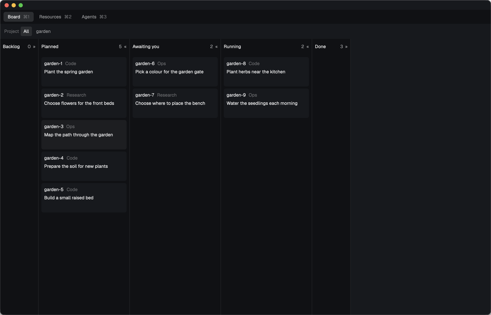

# Show orc in the Herdr App

The `orc` layout gives orc a window in the Herdr App, with a Board, a Resources and an Agents tab.
Install it once, and run `orc app install` again after each orc upgrade to pick up the new mods.
That is the only step after an upgrade: `orc app install` builds the mods from the checkout itself, so `bun run build` is not needed.

## Before you begin

- The Herdr App, run at least once so that `~/.config/herdr-app` exists.
- `orc` on the `PATH` of your login shell, since the mods run it through the App.
- `orc-dash` on that `PATH` too, for the Resources tab.

## Install the layout

To install the layout:

1. Run `orc app install`.
1. Run `herdr-app do layout.switch --name orc`, or press the `layout.switch` key until the `orc` layout shows.
   Check `keys.json` for your `layout.switch` binding.

`orc app install` copies the mods `orc-tabs`, `orc-board`, `orc-resources` and `orc-agents` into `~/.config/herdr-app/mods/`.
It copies `orc.json` and its preview `orc.svg` into `~/.config/herdr-app/layouts/`.
It adds `cmd-1`, `cmd-2` and `cmd-3` to the `layout:orc` section of `~/.config/herdr-app/keys.json`.
A key you already set in that section stays, and the command prints it as skipped.
The command writes only names that start with `orc`, so Herdr's own mods and layouts stay as they are.

## Read the tabs

| Tab | Key | What it shows |
| --- | --- | --- |
| Board | `cmd-1` | The backlog tasks in five lanes |
| Resources | `cmd-2` | The account names in `orc-dash snapshot --json --only quota` |
| Agents | `cmd-3` | The runs and the queued tasks, and the selected run's steps and step output |

Board reads `orc backlog --json` and `orc attention --json` when shown and every 10 seconds while shown.
Resources reads every minute.
Agents reads `orc runs --json` and `orc backlog --json` again every 4 seconds while it is the shown tab.
It also reads the selected run with `orc show <run> --json` and the selected step with `orc log <run> <step-id>`.
When a command fails or prints a document the tab cannot read, the tab shows the command and why.

## Read the Board tab

The Board groups tasks into Backlog, Planned, Awaiting you, Running, and Done.

Backlog stays empty because the backlog has no priority field.
Held tasks, tasks with unanswered parked questions, tasks with an open attention item for you, and closed tasks with an open PR appear in Awaiting you.
Taken and started tasks appear in Running.
Other new tasks appear in Planned, and other closed tasks appear in Done.
A PR whose state has not been read appears in Done.

Select a lane header to fold or open it.
Backlog and Done start folded.
Select a project to filter the lanes, or select All to show every project.
Select a card to mark it.
Each lane lists its tasks oldest first.

## Recapture the Board screenshot

The committed shot is the proof of the two-line clip.
The garden-6 title wraps to three lines and shows exactly two, with no word cut.
To recapture it, run `packages/herdr-app/scripts/capture-board.sh <fixture-dir> <output-png>` with a scratch `HOME` and an `HC_SESSION` starting with `fm-lab-`.
Use `tests/fixtures/herdr-board` as the fixture folder.
The script refuses the login `HOME`, keeps the scratch App off the live core, and quits only the App it started.
The live core's processes and terminals read the same before and after.

## Follow a run in the Agents tab

The Agents tab lists one card for each run, and one for each task still to start.
A card gives the task id and kind, or the run id and kind for a run started outside the backlog, the title, and where the run is now, such as `Fix 1`, `Question 1`, `Approve PR #48` or `orc exited 1`.
The cards sort by status in this order: Awaiting you, Running, Queued, Failed and Done.

| Status | When |
| --- | --- |
| Awaiting you | The run waits on your answer, or its PR is open and its task has no merge recorded |
| Running | The run is running |
| Queued | The task has not started, is held, or waits to run again |
| Failed | The run failed or was stopped |
| Done | The run succeeded, and its PR merged or it opened none |

To narrow the list, pick a project in the Project row or a status in the Status row.
To fold the list to a rail of ids coloured by status, select «, and select » to open it again.

The middle column lists the selected run's steps, those done and those still to come.
A report run shows only its Agent step.
A ship run shows Agent, Checks, Fix when checks fail, and No mistakes for the standard delivery or PR for a direct PR delivery.
A step shows ✓ when it passed, ✗ when it failed, ● while it runs, ◆ while it waits for you, and ○ when it has not started.
Select a step to show its output on the right: the Agent and Fix steps show what Pi writes as it works, and a Checks step shows the checks' output.
The output shows the full log and follows new lines as they are written.
Use your `layout.switch` key to go back to your own layout.

## Change the mods

The mods are TypeScript in `packages/herdr-app/mods/`, checked against the App's `gpui-kit.d.ts` and `herdr.d.ts`.
The copies of those two files sit in `packages/herdr-app/app-types/`, in a folder named for the App version they came from.
The copies hold no comments, because the comment gate in `bun run lint` refuses the App's doc blocks.
The copy script wraps `herdr.d.ts` in an ambient module for workspace typechecking.
An interface that extends an `import(...)` type extends a local alias because the dependency-cruiser parser refuses that form.
After the App updates, run `bun scripts/copy-app-types.ts <App version>` in `packages/herdr-app` to copy the new files from `~/.config/herdr-app`.
`bun run build` bundles each mod to one `main.js` and copies the result into `packages/run/dist/herdr-app/`.
`orc app install` writes that same folder before it copies from it, when the checkout has the sources, so changing a mod needs only `orc app install`.
A package install ships the built folder and no sources, so `orc app install` copies that folder as it is.
Run `herdr-app check packages/run/dist/herdr-app/mods/<mod>` on each mod you change.

## Related topics

- [The orc-dash dashboard](dash.md)
- [Contribute](contribute.md)
