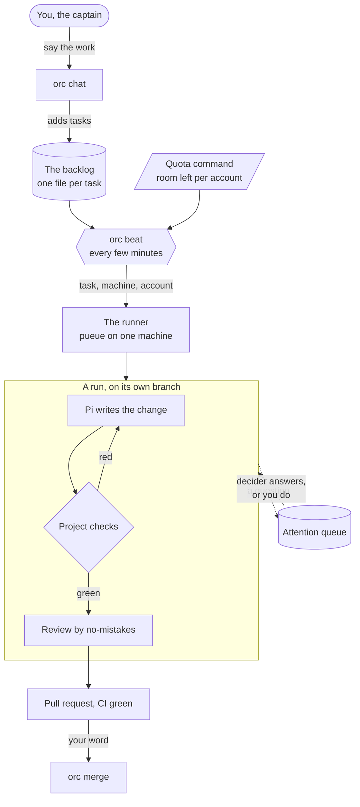

# How orc works

Orc takes work you describe and runs an AI agent on it on one of your machines.
It checks and reviews the result, then hands you a pull request or a report.
You are the captain: you say what needs doing, you answer the questions only you can answer, and you say when a pull request lands.

## The whole system

The picture follows one task from your words to a merged pull request.

Solid arrows are the path of the work.
Dotted arrows are the questions a run asks on the way and the answers that come back.

## The path of one task

Each step below is one part of orc, and each has its own page.

1. **The backlog holds the task.**
   You say the work in `orc chat`, or you write it in a Markdown file and run `orc backlog add`.
   Either way the task becomes one file in `~/.orc/backlog`, and the folder it sits in is its state.
   [The backlog](concepts/backlog.md) shows the states and the task kinds.
1. **The beat decides what starts.**
   `orc beat` runs from cron or launchd every few minutes.
   It starts a task only when the task has a priority, waits on nothing, and a machine has a free slot.
   [The beat](concepts/beat.md) lists every condition.
1. **The quota picks the account.**
   Before it starts anything, the beat runs your quota command and reads how much room each account has left.
   The run takes the account with the most room.
   [Accounts and quota](concepts/accounts-and-quota.md) shows the choice.
1. **The runner queues the run.**
   The beat hands the task to `orc runner start`, which queues it in pueue on the chosen machine.
   From then on the run belongs to that machine and outlives the beat and any SSH link.
   [The runner](concepts/runner.md) shows what the machine holds.
1. **The run does the work.**
   `orc run` makes a copy of the project on a new branch and starts the Pi agent in it.
   Pi writes the change and commits it.
   [A run](concepts/run.md) follows it step by step.
1. **The checks and the review judge it.**
   Orc runs the project's own checks, and Pi fixes what they refuse.
   Then no-mistakes reviews the branch, pushes it, opens the pull request and waits for green CI.
   [Checks and review](concepts/checks-and-review.md) shows both gates.
1. **You merge it.**
   The task closes done with its pull request, and `orc merge <task-id>` lands it once every check is green.
   [The merge](concepts/merge.md) lists what the merge refuses.

Two more parts sit beside that path.

- **Attention and the chat.**
  A run that meets a question it cannot settle asks it.
  The question lands in the attention queue.
  A small model called the decider answers a routine one from your written rules, and any other one waits for you.
  The chat posts each question that needs you and each task that closes.
  [The attention queue](concepts/attention.md) and [The chat](concepts/chat.md) show how.
- **The App.**
  The Herdr App layout and the `orc-dash` terminal dashboard show the backlog, the runs, the machines and the quota.
  They only read what the commands print, so everything they show you can also read with `orc backlog`, `orc runs` and `orc attention`.
  [The App and the dashboard](concepts/app.md) shows the screens.

## Where each part lives

Orc has no server.
Its state is files on disk and queues in pueue, so a restart picks up where it stopped.

| Part | Where it lives |
| --- | --- |
| The backlog, the attention queue, `dispatch.json` and `projects.json` | `~/.orc/backlog`, on the one machine that runs `orc beat` |
| The providers and the models | `~/.orc/config.json`, on each machine that runs tasks |
| A queued or running task | The pueue group `orc` on the machine that runs it |
| The record of each run | `~/.orc/runs/<run-id>` on the machine that ran it |
| Your rules for the chat and the decider | `~/.orc/orchestrator.md` |

`ORC_HOME` moves `~/.orc` elsewhere when set.

## The words orc uses

| Word | What it means |
| --- | --- |
| Captain | You, the person who owns the work and gives the answers |
| Task | One piece of work in the backlog, with an id such as `orc-9` |
| Run | One attempt at a task by `orc run`, with its own branch and its own record |
| Beat | One pass of `orc beat`, which starts what can start and closes what finished |
| Slot | One place for a running task on a machine, counted in `dispatch.json` |
| Pi | The coding agent orc runs, and the only one |
| no-mistakes | The review tool that takes a checked branch to a pull request with green CI |
| pueue | The queue on each machine that holds the runs |
| nono | The sandbox a run you start by hand works in by default |
| Decider | The small model that answers a run's routine questions from your rules |

## Related topics

- [Run your first task](tasks/run-your-first-task.md)
- [Run a backlog from the chat](tasks/run-a-backlog.md)
- [Commands](reference/commands.md)
- [What orc does](features.md)
