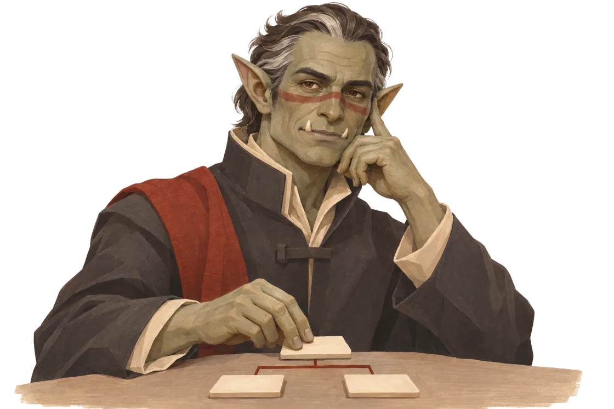

# How orc works

One chat to run your AI agent work on all your machines and models, with a backlog, live monitoring and Herdr App dashboards.

Solid arrows are the path of the work.
Dotted arrows are the questions a run asks on the way and the answers that come back.

<svg class="paper-defs" aria-hidden="true"><filter id="paper-rough" x="-20%" y="-20%" width="140%" height="140%"><feTurbulence type="fractalNoise" baseFrequency="0.9" numOctaves="2" seed="7" result="n"/><feDisplacementMap in="SourceGraphic" in2="n" scale="2.2"/></filter></svg><svg class="running" viewBox="0 0 24 24" fill="currentColor" aria-hidden="true"><path d="M10 4.5Q10 2.7 11.7 3.7L22 10.3Q24 11.7 22 13.1L11.7 20Q10 21 10 19.2Z"/></svg>Running<svg class="waiting" viewBox="0 0 24 24" fill="currentColor" aria-hidden="true"><rect x="5" y="3" width="5" height="18" rx="2.5"/><rect x="14" y="3" width="5" height="18" rx="2.5"/></svg>Waiting<svg class="done" viewBox="0 0 24 24" fill="currentColor" aria-hidden="true"><path d="M4 12L9 17L20 5" fill="none" stroke="currentColor" stroke-width="5" stroke-linecap="round" stroke-linejoin="round"/></svg>Done<svg class="failed" viewBox="0 0 24 24" fill="currentColor" aria-hidden="true"><path d="M5 5L19 19M19 5L5 19" fill="none" stroke="currentColor" stroke-width="5" stroke-linecap="round"/></svg>Failed<svg class="attention" viewBox="0 0 24 24" fill="currentColor" aria-hidden="true"><path fill-rule="evenodd" d="M12 1C5.5 1 1 5.5 1 11.5C1 14.3 2 16 3.2 17.6L1.7 21.2Q1 23 3.1 22.2L7.2 20.5C8.5 21.2 10.3 22 12 22C18.5 22 23 17.5 23 11.5S18.5 1 12 1ZM10.3 5.3A1.7 1.7 0 0 1 13.7 5.3V12A1.7 1.7 0 0 1 10.3 12ZM12 15.5A1.7 1.7 0 1 0 12 18.9A1.7 1.7 0 1 0 12 15.5Z"/></svg>Attention

You say what needs doing, you answer the questions only you can answer, and you say when a pull request lands.

## The path of one task

Each step below is one part of orc, and each has its own page.

1. **The backlog holds the task.**
   You say the work in `orc chat`, or you write it in a Markdown file and run `orc backlog add`.
   Either way the task becomes one file in `~/.orc/backlog`, and the folder it sits in is its state.
   [The backlog](concepts/backlog.md) shows the states and the task kinds.
1. **The beat decides what starts.**
   `orc beat` runs from cron or launchd every few minutes.
   It starts a task only when the task has a priority, waits on nothing, and a machine has a free slot.
   [The beat](concepts/beat.md) lists every condition.
1. **The quota picks the account.**
   Before it starts anything, the beat runs your quota command and reads how much room each account has left.
   The run takes the account with the most room.
   [Accounts and quota](concepts/accounts-and-quota.md) shows the choice.
1. **The runner queues the run.**
   The beat hands the task to `orc runner start`, which queues it in pueue on the chosen machine.
   From then on the run belongs to that machine and outlives the beat and any SSH link.
   [The runner](concepts/runner.md) shows what the machine holds.
1. **The run does the work.**
   For a ship task, `orc run` makes a copy of the project on a new branch and starts the Pi agent in it.
   Pi writes the change and commits it, while a scout or task run writes a report instead.
   [A run](concepts/run.md) follows it step by step.
1. **The checks and the review judge it.**
   Orc runs the project's own checks, and Pi fixes what they refuse.
   The delivery mode then decides whether no-mistakes reviews the branch before orc opens the pull request.
   [Checks and review](concepts/checks-and-review.md) shows both gates.
1. **You merge it.**
   For a ship task, the task closes done with its pull request, and `orc merge <task-id>` lands it once every check is green.
   [The merge](concepts/merge.md) lists what the merge refuses.

Two more parts sit beside that path.

- **Attention and the chat.**
  A run that meets a question it cannot settle asks it.
  The question lands in the attention queue.
  A model called the decider answers a routine one from written instructions, and any other one waits for you.
  The chat posts each question that needs you and each task that closes.
  [The attention queue](concepts/attention.md) and [The chat](concepts/chat.md) show how.
- **The App.**
  The Herdr App layout and the `orc-dash` terminal dashboard show the backlog, the runs, the machines and the quota.
  They only read what the commands print, so everything they show you can also read with `orc backlog`, `orc runs` and `orc attention`.
  [The app and the dashboard](concepts/app.md) shows the screens.

## Where each part lives

Orc has no server.
Its state is files on disk and queues in pueue, so a restart picks up where it stopped.

| Part | Where it lives |
| --- | --- |
| The backlog, the attention queue, `dispatch.json` and `projects.json` | `~/.orc/backlog`, on the one machine that runs `orc beat` |
| The providers and the models | `~/.orc/config.json`, on each machine that runs tasks |
| A queued or running task | The pueue group `orc` on the machine that runs it |
| The record of each run | `~/.orc/runs/<run-id>` on the machine that ran it |
| Your rules for the chat and the decider | `~/.orc/orchestrator.md` |

<code>ORC_HOME</code> moves <code>~/.orc</code> elsewhere when set.

## The words orc uses

| Word | What it means |
| --- | --- |
| Task | One piece of work in the backlog, with an id such as `orc-9` |
| Run | One attempt at a task by `orc run`, with its own record, and its own branch for a ship task |
| Beat | One pass of `orc beat`, which starts what can start and closes what finished |
| Slot | One place for a running task on a machine, counted in `dispatch.json` |
| Pi | The coding agent orc runs, and the only one |
| no-mistakes | The review tool that takes a checked branch to a pull request with green CI |
| pueue | The queue on each machine that holds the runs |
| nono | The sandbox a run you start by hand works in by default |
| Decider | The model that answers a run's routine questions from written instructions |

## Related topics

- [Run your first task](tasks/run-your-first-task.md)
- [Run a backlog from the chat](tasks/run-a-backlog.md)
- [Commands](reference/commands.md)
- [What orc does](features.md)

